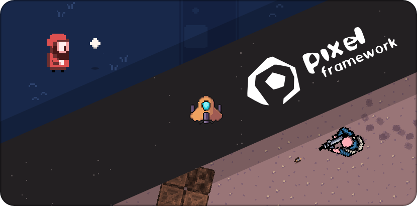

## Pixel Framework ##

### What is this repository for? ###

This repository contains the Pixel Framework and associated modules/dependencies.

### Description ###

The Pixel Framework aims to provide a high performance and lightweight OpenGL 2D game development workflow. It is
influenced by the popular XNA framework and is built on top of the [LWJGL](https://www.lwjgl.org/) (Desktop) and OpenGL ES (Android).

> :book: For practical details on how to use this framework, please check the [wiki page](https://github.com/joafalves/pixel-community/wiki).

Pixel is designed to be modular and easy to extend. Check 
[here](https://github.com/joafalves/pixel-community/wiki/E.-Extensions-Overview) for more details on how to use the 
available extensions (or how to create your own).

### Examples ##

Check the :file_folder: [demos folder](https://github.com/joafalves/pixel-community/tree/devel/demos) for examples.

##### Basic example #####

```java
public class HelloPixel extends GameApp {

    private static final Layer WORLD = Layer.sorted("world"); // drawn by depth
    private static final Layer HUD = Layer.ordered("hud");    // drawn in order, on top

    private RenderPipeline pipeline;
    private Camera2D camera;
    private Texture hero;
    private SdfFont font;

    @Override
    public void load() {
        // the game context is available from load() on: graphics(), content(), audio(), window(), settings()
        camera = new Camera2D(context());
        pipeline = RenderPipeline.builder(graphics().getRenderBackend())
                .pass(camera, WORLD)                     // the world, through the camera
                .pass(new ScreenSpace(context()), HUD)   // the HUD, in screen units
                .build();
        // the content manager is shared by the whole game and released by the framework
        hero = content().loadTexture("images/hero.png");
        font = content().load("fonts/ui.ttf", SdfFont.class);
    }

    @Override
    public void draw(DeltaTime delta) {
        Canvas world = pipeline.canvas(WORLD);
        world.roundRect(-100, 40, 200, 24, 12).fill(Color.GOLD).shadow(0, 6, 12, Color.BLACK);
        world.image(hero, 0, 40).anchor(0.5f, 1f).depth(40);
        pipeline.canvas(HUD).text(font, "Hello, Pixel", 16, 16).size(28).stroke(2, Color.BLACK);
        pipeline.render();
    }

    @Override
    public void dispose() {
        pipeline.dispose(); // created by you: you dispose it
    }

    public static void main(String[] args) {
        var settings = new WindowSettings("Hello", 800, 600);
        settings.setDevMode(true); // F1: the built-in dev tools
        // the same GameApp runs on other platforms through their launcher (e.g. AndroidLauncher)
        DesktopLauncher.run(new HelloPixel(), settings);
    }
}
```

The [rendering guide](docs/rendering.md) covers layers, pipelines, the canvas (shapes, paths, text, images), render
targets and post effects, materials (custom shaders) and frame inspection. The [dev tools](docs/dev-tools.md) show
frame times, draw calls, assets, the log and your own values while the game runs. `graphics().createSpriteBatch()`
is still there for XNA-style sprite drawing.

> Looking for ECS support? Check [this built-in extension!](https://github.com/joafalves/pixel-community/wiki/E1.-ECS-(Entity-Component-System))

### Project structure ###

The framework functionality is divided into multiple modules which can be imported individually as required.

##### Root directory structure #####

    .demos/                         # Feature showroom and learning examples
    .extensions/                    # Extensions for the framework (optional)
        ├── ext-decs                # Alternative ECS (worlds, groups, systems)
        ├── ext-ecs                 # Entity component system extension
        ├── ext-ecs-extra           # ECS utility components
        ├── ext-log4j2              # Log4j2 extension
        ├── ext-network             # Network extension
        └── ext-tween               # Tween extension
    .modules/                       # The principal modules of the framework
        ├── commons                 # Common utility classes
        ├── content                 # Common Content classes (Texture, Font, Audio, ...)
        ├── core                    # Core module (GameApp, GameContext, GameSettings, Camera2D, ...)
        ├── graphics                # Graphics API module
        ├── math                    # Math module (Vector, Matrix, ...)
        └── pipeline                # Generic Pipeline processing module
    .platform/
        ├── android                 # Android platform implementation (OpenGL ES 3.0)
        ├── desktop                 # Desktop platform implementation (LWJGL3, OpenGL 3.3)
        └── opengl                  # Renderer shared by desktop and Android (through GLApi)
    .resources/
        └── images                  # Project resource images
    .build.gradle                   # Gradle build file
    .settings.gradle                # Gradle settings file

##### Inner module structure #####

    .modules/
        └── *module*                 # Presented file structure similar in all modules
            ├── build                # Module build directory
            │   ├── docs             # Generated documentation files (run 'javadoc' gradle task)
            │   └── libs             # Generated .jar files (run 'jar' gradle task)
            ├── src                  # Module Source folder
            │   ├── main             # Module Main Source classes
            │   └── test             # Module Test Source classes
            └── build.gradle         # Module Gradle build file (contains inner dependency definitions)

### Documentation ###

- [Rendering guide](docs/rendering.md): layers, pipelines, the canvas, text, render targets and post effects,
  materials (custom shaders), frame inspection and picking.
- [Dev tools](docs/dev-tools.md): the in-game overlay (F1) with frame times, rendering statistics, assets, the log
  and your own watches and switches.
- [URP v2 design](docs/design/urp-v2.md): how the renderer is built, phase by phase, with the decisions behind it.

To check rendering changes: `./gradlew :pixel-demo-desktop-learning:renderGolden` compares fixed scenes with
reference images, and `./gradlew :pixel-demo-desktop-learning:renderBenchmark` measures throughput.

### Runtime requirements ###

- Java 17.x+

### Development requirements ###

- JDK 17 or newer to run the build (the libraries are always compiled for Java 17)
- Gradle 9.x — use the included wrapper (`./gradlew`), no local install needed

### Runtime OS compatibility ###

For desktop, the same support as the [LWJGL](https://www.lwjgl.org/) dependency, which includes:

- Windows (x86, x64, arm64)
- MacOS (x64, arm64)
- Linux (x86, x64, arm64, arm32)

> Requires OpenGL 3.3+ support.

There is also an Android platform implementation available (OpenGL ES 3.0, Android 11 / API 30+) - **Experimental**.
It uses the same renderer as desktop. Audio and game touch input are not implemented on Android yet (the activity
passes touches to the dev tools first, see [docs/dev-tools.md](docs/dev-tools.md)). Fonts can't be generated on Android: bake them on desktop with `SdfFontBaker` and load the
pre-baked `.json` + `.png`.

#### Building for Android ####

The Android modules are optional and off by default, so an installed Android SDK does not slow down or break
desktop builds. To include them, set `pixel.android=true` in one of:

- the command line: `./gradlew -Ppixel.android=true ...`
- `local.properties` (per developer, not committed): `pixel.android=true`
- the `PIXEL_ANDROID` environment variable

The SDK is taken from `sdk.dir` in `local.properties` (Android Studio writes it) or `ANDROID_HOME`; with
`pixel.android=true` and no SDK, the build stops with an error. To build, install and start the demo on a
connected device or a running emulator (add `-Pscreenshot=build/android.png` to save the screen):

```bash
./gradlew -Ppixel.android=true :pixel-demo-android-learning:androidRun
```

### FAQ ###

1. I'm unable to run Pixel on MacOS due to system error.
    - Add `-XstartOnFirstThread` as a java VM Option before running your project.
2. Is Pixel compatible with Kotlin?
    - Yes, Pixel is fully compatible with Kotlin. Check
      this [demo](https://github.com/joafalves/pixel-community/tree/devel/demos/kotlin) for an example.
3. Is Pixel available as a Maven dependency?
    - Yes, Pixel is available as a public Maven
      dependency. [Click here](https://github.com/joafalves/pixel-community/wiki/1.-Getting-Started) for more details on
      how to import using Maven or Gradle.
4. Is Pixel free?
    - Yes, Pixel is completely free to use and distribute as an application dependency.

### Who do I talk to? ###

* It's a bug or a feature request? [Please open an issue](https://github.com/joafalves/pixel-community/issues).
* Repo owner or moderator.
